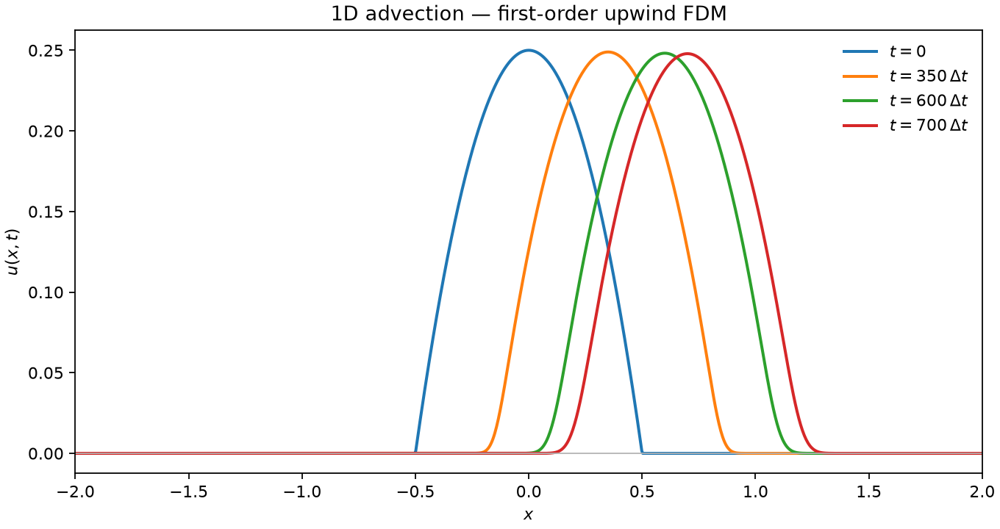
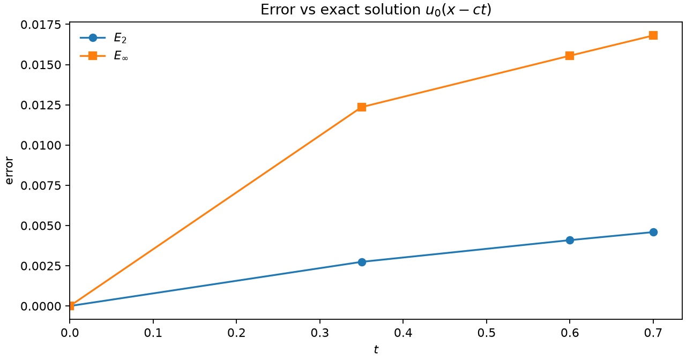
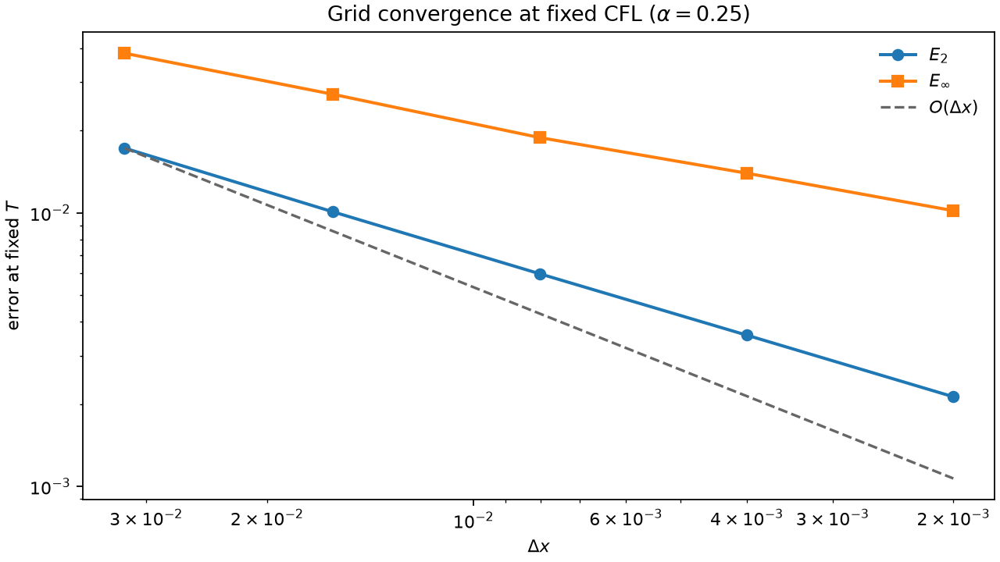

# Finite-Difference Advection Solver

A compact **C11** case study: solve the 1D linear advection equation with a
first-order upwind finite-difference scheme, measure error against the exact
solution, and verify the expected convergence rate.

---

## The equation

A scalar field $u(x,t)$ is transported at constant speed $c$:

$$
\frac{\partial u}{\partial t} + c \frac{\partial u}{\partial x} = 0.
$$

The exact Cauchy solution is a pure translation of the initial data,

$$
u(x,t) = u_0(x - c t).
$$

Here $u_0$ is a compact parabolic pulse on $[-2, 2]$; the numerical method
must carry that pulse to the right without blowing up. Full derivation,
stability condition, and norms: [docs/methodology.md](docs/methodology.md).

---

## The scheme

First-order upwind ($c > 0$), with Courant number $\alpha = c\,\Delta t / \Delta x$:

$$
u_i^{n+1}
= u_i^{n}
- \alpha \bigl(u_i^{n} - u_{i-1}^{n}\bigr),
\qquad 0 < \alpha \le 1.
$$

| Choice | Detail |
| --- | --- |
| Domain | $x \in [-2, 2]$, default $N = 1000$ |
| Time | $\Delta t = 10^{-3}$, $700$ steps (demo) |
| IC | $u_0(x) = 1/4 - x^{2}$ for $|x| \le 1/2$, else $0$ |
| BC | Homogeneous Dirichlet |
| CFL | $\alpha \approx 0.25$ |

---

## Story of a pulse

At $t = 0$ the pulse sits at the origin. As the scheme advances, the profile
moves right — and **broadens**. That smoothing is numerical diffusion, the
signature trade-off of classical first-order upwinding. The dashed curve is
the exact translation at the final time: same centre of mass, taller peak,
sharper edges.



---

## Error grows in time

Against $u_0(x - c t)$, discrete norms

$$
E_2 = \sqrt{\Delta x \sum_i (u_i - u^{\mathrm{ex}}_i)^2},
\qquad
E_\infty = \max_i |u_i - u^{\mathrm{ex}}_i|
$$

start at machine zero and rise as diffusion eats the peak:

| Step | $t$ | $E_2$ | $E_\infty$ |
| --- | --- | --- | --- |
| 0 | 0.00 | $0$ | $0$ |
| 350 | 0.35 | $2.74 \times 10^{-3}$ | $1.24 \times 10^{-2}$ |
| 600 | 0.60 | $4.09 \times 10^{-3}$ | $1.56 \times 10^{-2}$ |
| 700 | 0.70 | $4.59 \times 10^{-3}$ | $1.68 \times 10^{-2}$ |



---

## Refining the grid

Holding CFL fixed ($\alpha = 0.25$) so $\Delta t \propto \Delta x$, and
measuring error at $T \approx 0.5$, successive dyadic refinements give an
observed $E_2$ rate $p \approx 0.75$ — first-order behaviour limited by the
pulse’s kink at the support edges ($u_0$ is $C^0$ but not $C^1$). $E_\infty$
converges more slowly, as expected for that limited regularity. The dashed
reference is the ideal $O(\Delta x)$ slope.



| $N$ | $\Delta x$ | $E_2$ | rate $E_2$ |
| --- | --- | --- | --- |
| 125 | $3.23 \times 10^{-2}$ | $1.72 \times 10^{-2}$ | — |
| 250 | $1.61 \times 10^{-2}$ | $1.01 \times 10^{-2}$ | $0.77$ |
| 500 | $8.02 \times 10^{-3}$ | $5.99 \times 10^{-3}$ | $0.75$ |
| 1000 | $4.00 \times 10^{-3}$ | $3.57 \times 10^{-3}$ | $0.74$ |
| 2000 | $2.00 \times 10^{-3}$ | $2.13 \times 10^{-3}$ | $0.75$ |

---

## Architecture

```
include/     params · field · solver · error · io
src/         library + drivers (main, convergence)
scripts/     storytelling plots
docs/        methodology with LaTeX
figures/     tracked plots for this README
.github/     CI: build, demo, convergence rates
```

| Module | Role |
| --- | --- |
| `params` | Configuration, $\Delta x$, CFL validation |
| `field` | Grid + rolling solution buffers |
| `solver` | Upwind step and time loop |
| `error` | Exact pulse, $E_2$ / $E_\infty$ |
| `io` | CSV snapshots |
| `main` / `convergence` | Demo run and fixed-CFL refinement study |

Only two time levels live in memory; selected frames and the convergence
table are exported for analysis.

---

## Build & run

```bash
make study        # demo + convergence + all figures
# or step by step:
make run          # output/u_tXXXX.csv, output/errors.csv
make convergence  # output/convergence.csv
pip install -r requirements.txt
make plot
```

Requires a C11 compiler and Python 3 with `matplotlib` / `numpy` / `pandas`.

---

## Stack

**C11** numerical core · **Make** orchestration · **Python** plots only ·
**GitHub Actions** build + error/convergence smoke checks
